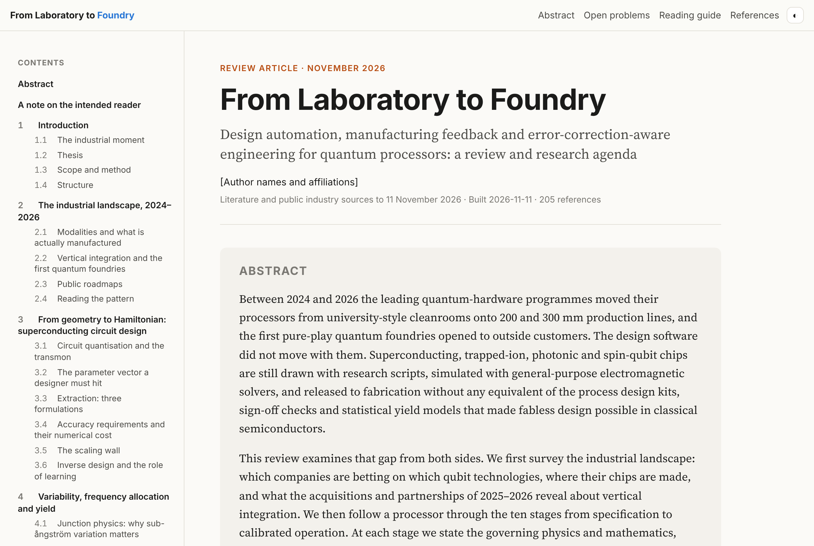
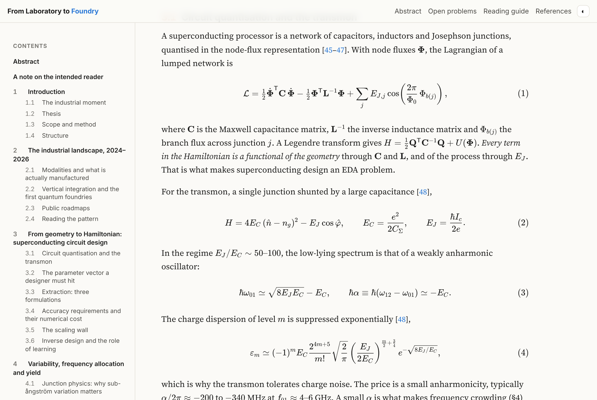
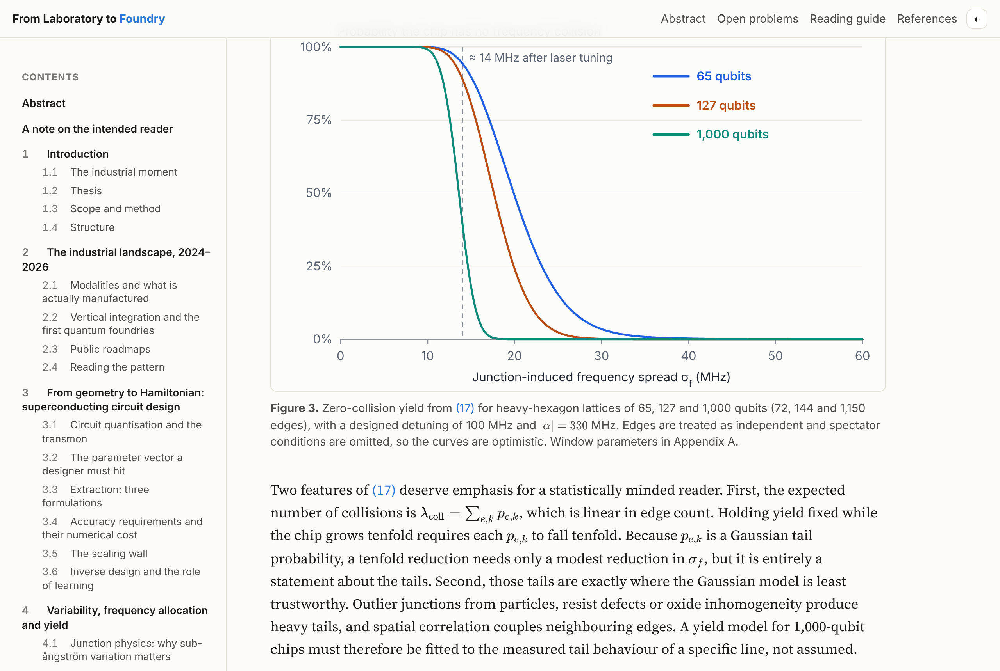
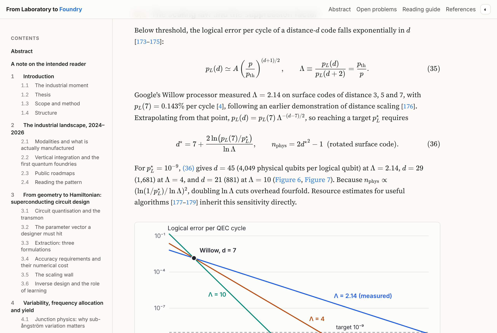
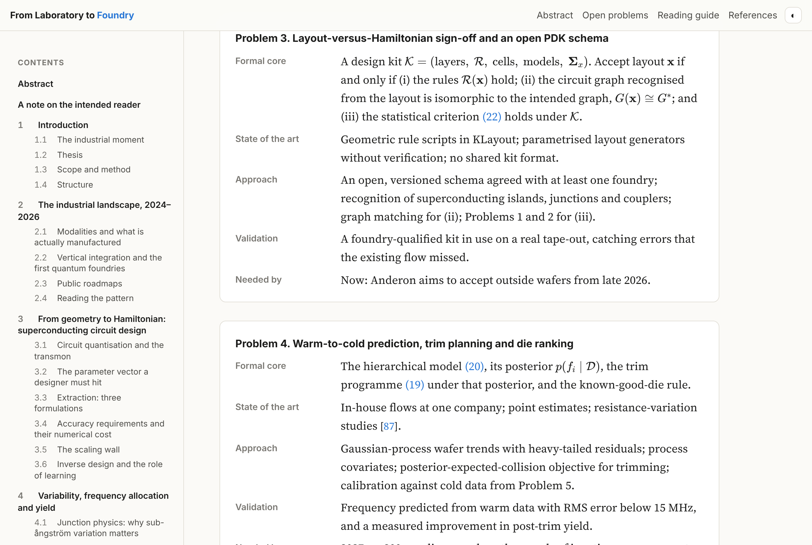

# Quantum EDA tools: from laboratory to foundry

A review article, with a research agenda, on design automation for quantum processors. It covers
what the industry is building and buying, the physics and mathematics of each step from qubit
design to calibrated operation, what existing tools do, and seven open problems worth attacking.

**Read it:** open [`docs/index.html`](docs/index.html) in a browser, or enable GitHub Pages
(Settings → Pages → Deploy from branch → `/docs`). The page is self-contained and renders
equations offline with vendored KaTeX.



## Companion course: Foundations of Quantum Engineering

A seven-book course, written as preparation for the review, in `docs/foundations/`
(open [`docs/foundations/index.html`](docs/foundations/index.html)). Every chapter has goals,
derivations, worked examples, a "Toward quantum EDA" box linking it to design tools and to the
review, and exercises with full solutions. Books link to each other and into the review.

| # | Book | Covers |
|---|---|---|
| 1 | Mathematics for Quantum Engineering | complex numbers, Dirac notation, eigenvalues, tensor products, ODEs, Fourier analysis, probability, numerics and optimisation |
| 2 | Classical Physics for Quantum Engineers | Lagrangians and Hamiltonians, oscillators, capacitance matrices, Maxwell, transmission lines, waveguides, thermal noise |
| 3 | Quantum Mechanics | postulates, tunnelling, harmonic oscillator, Rabi, perturbation theory, density matrices, decoherence, second quantisation |
| 4 | Quantum Information and Computation | circuits, teleportation, Grover, Shor, benchmarking, stabiliser codes, surface code, the stack |
| 5 | Quantum Photonics | field quantisation, states of light, Hong–Ou–Mandel, cavity QED, sources and detectors, integrated photonics, fusion and GKP |
| 6 | Quantum Hardware | superconductivity, Josephson junctions, transmon and fluxonium, circuit QED, gates, loss budgets, ions, atoms, spins |
| 7 | Making Quantum Chips | fabrication, classical EDA, EM simulation, yield, packaging and test, statistical learning, a map of the review |

Recommended order: 1 → 2 → 3 → 4 → 5 → 6 → 7 → the review (the roadmap page shows the
dependencies and shorter routes). About 116,000 words, 182 numbered equations, 15 computed figures
and 309 exercises with solutions. All seven books are written for readers with no background:
each chapter has a plain-language overview, step-by-step worked examples, quick checks,
common-confusion boxes and key takeaways. Books 1–3 and 5–7 add glossaries, and Books 1–3
end every chapter with a short runnable Python example (NumPy and SciPy only, each one
tested); Books 1 and 5–7 also include worked design chapters.

## Contents of the review

1. Introduction: the 2024–2026 industrial moment, and the thesis
2. Industrial landscape: modalities, foundries, acquisitions, roadmaps
3. From geometry to Hamiltonian: circuit quantisation, extraction, scaling, inverse design
4. Variability, frequency allocation and yield
5. Materials, interfaces and the coherence budget
6. Packaging, 3D integration and wiring
7. Test, characterisation and calibration
8. Ion traps, photonics, spins, neutral atoms and topological qubits
9. Error correction as the stack-agnostic layer
10. The existing tool landscape and gap map
11. Seven open problems, stated formally
12. Commercial scope, timing and risk
13. Conclusion, plus appendices: figure parameters, glossary, reading guide

About 12,600 words, 39 numbered equations, 7 computed figures, 7 tables and 205 references.

| Equations | Computed figures |
|---|---|
|  |  |
|  |  |

## Repository layout

```
curriculum/
  series.json            the seven books: order, prerequisites, titles
  template.html          page shell shared by every book
  roadmap.html           body of the series roadmap page
  <n>-<name>/*.html      chapters of each book, in reading order
  references.bib         textbooks and papers cited by the series
  library-site-json.patch  entries for jaswin90.github.io/site.json (see below)
review/
  template.html          page shell (title block, contents, KaTeX set-up)
  sections/*.html        the article, one file per section, in reading order
references/
  references.bib         every citation (BibTeX; import into Zotero or similar)
  reading-list.md        annotated, tiered reading guide
scripts/
  make_figures.py        computes every figure from the equations in the text
  build.py               numbers sections/equations/figures, resolves citations
  make_foundation_figures.py  computed figures for the series
  build_foundations.py   builds docs/foundations/ (books, roadmap, cross-references)
  roadmap_svg.py         redraws the reading-order diagram from series.json
docs/                    built site (GitHub Pages root)
  index.html             the assembled article (generated; do not edit)
  foundations/           the series: index.html (roadmap) and one folder per book (generated)
  assets/css/book.css   book stylesheet (library theme variables)
  assets/js/book.js     dark-mode toggle and library hooks
  figures/*.svg          generated figures
  vendor/katex/          KaTeX 0.16.11 (MIT licence)
screenshots/             previews used in this README
Makefile
```

## Building

Python 3.9+ only, standard library; no packages to install.

```sh
make              # regenerate all figures, the review and the series
make figures      # figures only
make html         # review only
make foundations  # series only
```

The series uses the review's markup (below) plus `@b3:sec-x` for a label in Book 3, `@lf:sec-x`
for a label in the review, and `@b3:sec-x+` to print the section title as well. The build fails on
an unresolved reference and on a `<` inside maths (write `\lt`, since a raw `<` starts an HTML tag).

### Publishing the series in the library

Each book of the series is published as a volume inside this repository's book on
jaswin90.github.io (`"within": "Lab-to-Foundry"` with a `path` under `foundations/`).
`curriculum/library-site-json.patch` adds the roadmap and the seven books to the
Quantum Engineering field of `site.json` and points the Lab-to-Foundry entry at the branch that
contains the series. Apply it in the jaswin90.github.io repository (`git apply`) and push.

### Writing conventions in `review/sections/`

| Markup | Meaning |
|---|---|
| `[@key]`, `[@a; @b]` | citation, numbered in order of first use from `references.bib` |
| `<section id="sec-x"><h2>` | numbered section (`class="unnumbered"`, `data-appendix` also supported) |
| `<div class="eq" id="eq-x">$$…$$</div>` | numbered display equation |
| `\( … \)` | inline maths (`$` is not a delimiter, so prices like $1.8 bn are safe) |
| `<figure id="fig-x">`, `<figure class="tbl" id="tab-x">` | numbered figure or table |
| `@sec:x`, `@eq:x`, `@fig:x`, `@tab:x` | cross-references |

The build fails on an unknown citation key or an unresolved cross-reference, and lists any
uncited bibliography entries.

## Status and caveats

- Industry information is from public sources to 11 November 2026. Figures marked "reported" are
  press figures, not company disclosures. Intel–Classiq had not closed at the time of writing.
- Bibliography entries tagged `verify` were compiled from memory and need their volume and page
  checked before external use.
- Every figure is computed from a stated model (Appendix A of the review), not digitised from data.
  The collision-yield curve in particular is an illustrative model.
- The byline is set in `review/template.html`.
